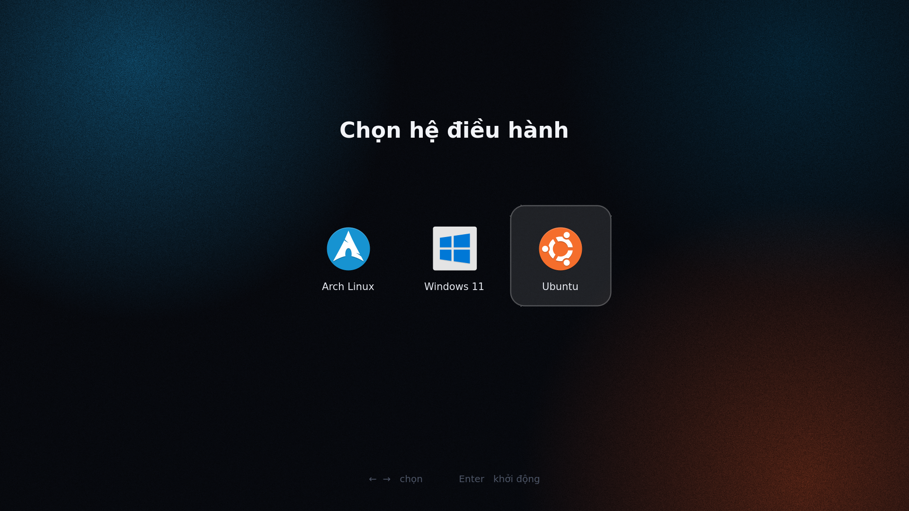
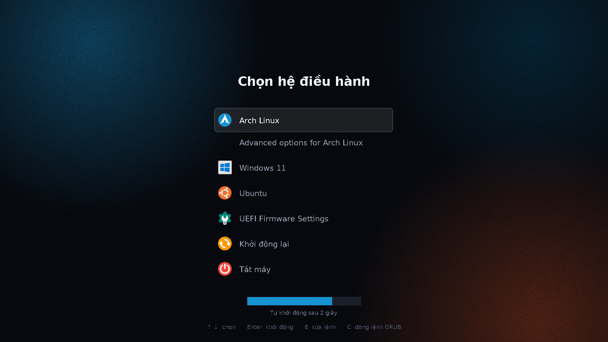

# Triboot — Bộ giao diện khởi động 3 hệ điều hành (Arch Linux · Windows 11 · Ubuntu)

Bộ giao diện và công cụ quản lý khởi động đồng bộ dành cho máy tính chạy **Triple-Boot (Arch Linux, Windows 11, Ubuntu)** chuẩn UEFI, bao gồm:

1. **Menu chọn hệ điều hành dạng ngang**:
   - **rEFInd Theme (`refind/`)**: Giao diện tối giản chỉ hiện 3 icon hệ điều hành, tự động đổi **lời chào theo buổi** (*Chào buổi sáng / chiều / tối*) và tối ưu tải tức thì bằng ảnh `BMP` không nén (`fast-boot`).
   - **Custom UEFI Menu (`uefi-menu/`)**: Ứng dụng UEFI độc lập viết bằng C thuần (`triboot.efi`, không phụ thuộc `gnu-efi`), chạy ở 60 FPS với hiệu ứng trượt mượt, quầng sáng "thở" (`breath`), tự tính giờ địa phương từ phần cứng và thanh đếm ngược theo màu từng hệ điều hành.
2. **Màn hình chờ Plymouth (`effects/`)**:
   - Đồng bộ cho cả **Arch Linux** và **Ubuntu**.
   - Tự động phân biệt trạng thái hệ thống:
     - **Khi bật máy (`boot-up`)**: Hiện *"Chào mừng trở lại, <Tên>"* + *"Arch Linux / Ubuntu đang khởi động"*.
     - **Khi tắt máy (`shutdown`)**: Hiện *"Hẹn gặp lại, <Tên>"* + *"Arch Linux / Ubuntu đang tắt máy"*.
     - **Khi khởi động lại (`reboot`)**: Hiện *"Hẹn gặp lại, <Tên>"* + *"Arch Linux / Ubuntu đang khởi động lại"*.
3. **Theme GRUB dự phòng (`triboot/`)**:
   - Giao diện GRUB dọc gọn gàng, tự động ẩn các mục thừa và làm menu dự phòng an toàn (`fallback=1` tự rơi về Arch Linux nếu bộ nạp chính gặp sự cố).

---

## Hình ảnh minh họa

| Menu ngang (rEFInd / UEFI) | Menu dọc (GRUB) | Màn hình Plymouth |
| :---: | :---: | :---: |
|  |  |  |

---

## Cấu trúc thư mục

Toàn bộ dự án sử dụng **duy nhất 1 script chạy [`install.sh`](install.sh)** ở thư mục gốc, các cấu hình và hàm xử lý được tách thành mô-đun trong [`lib/`](lib/):

```text
grub-theme-3os/
├── install.sh              # Trình cài đặt, cập nhật & hoàn tác duy nhất
├── lib/
│   ├── config.sh           # Cấu hình trung tâm (Tên, chế độ boot, UUID phân vùng, màu sắc)
│   ├── common.sh           # Các hàm tiện ích dùng chung & kiểm tra an toàn
│   ├── grub.sh             # Quản lý GRUB, ẩn mục thừa, tạo pacman hook, tối ưu fast-boot
│   ├── refind.sh           # Cài đặt rEFInd & tối ưu ảnh nền BMP không nén
│   ├── effects.sh          # Sinh ảnh lời chào/tạm biệt, cài đặt Plymouth (Arch & Ubuntu)
│   └── uefi.sh             # Tạo asset .tbi, biên dịch và cài đặt ứng dụng UEFI (triboot.efi)
├── triboot/                # Tài nguyên theme GRUB (ảnh nền, icon, font .pf2)
├── refind/                 # Cấu hình mẫu refind.conf & theme rEFInd
├── effects/                # Tài nguyên Plymouth (Arch & Ubuntu) và banner 3 buổi
└── uefi-menu/              # Mã nguồn C của ứng dụng UEFI menu (src/triboot.c, src/efi.h)
```

---

## Yêu cầu hệ thống (Dependencies)

Trên **Arch Linux**:
```bash
sudo pacman -S --needed grub efibootmgr refind plymouth imagemagick librsvg ttf-dejavu papirus-icon-theme gcc binutils make
```

Trên **Ubuntu** *(nếu cài Plymouth trực tiếp từ trong Ubuntu)*:
```bash
sudo apt install plymouth plymouth-themes
```

---

## Cấu hình trước khi cài đặt (Quan trọng!)

> [!WARNING]
> **Mỗi máy tính có UUID/PARTUUID phân vùng khác nhau.** Trước khi chạy trên một máy mới, bạn **bắt buộc** phải kiểm tra bằng lệnh `lsblk -f` hoặc `blkid` và cập nhật lại mục **2. Thông tin phân vùng phần cứng** trong file [`lib/config.sh`](lib/config.sh):

```bash
# Mở file cấu hình trung tâm:
nano lib/config.sh
```

Các thông số chính trong [`lib/config.sh`](lib/config.sh):
- `USER_NAME="TaZek"`: Tên hiển thị trên lời chào / lời tạm biệt (để `""` nếu không muốn hiện tên).
- `BOOT_MODE="refind"`: Chọn `"refind"` | `"uefi"` | `"grub"`.
- `FAST_BOOT=1`: Tắt màn hình đồ họa GRUB trung gian và dùng ảnh BMP không nén để vào thẳng menu nhanh nhất.
- `ARCH_ESP_UUID`, `ARCH_ESP_PARTUUID`, `ARCH_ROOT_UUID`: UUID/PARTUUID của phân vùng EFI (`/boot`) và Root (`/`) của Arch Linux.
- `NVME_ESP_UUID`, `NVME_ESP_PARTUUID`, `UBUNTU_ROOT_UUID`: UUID/PARTUUID của phân vùng EFI chứa Windows/Ubuntu và phân vùng Root (`/`) của Ubuntu.

---

## Hướng dẫn sử dụng

### 1. Cập nhật nhanh lời chào / tạm biệt + Plymouth + Fast-Boot
```bash
sudo ./install.sh
```
Hoặc đổi tên hiển thị ngay từ dòng lệnh:
```bash
sudo ./install.sh --name "Tên của bạn"
```

### 2. Cài đặt toàn bộ từ đầu
```bash
sudo ./install.sh --all
```

### 3. Chạy riêng từng phần theo nhu cầu
```bash
sudo ./install.sh --effects     # Chỉ tạo lại ảnh lời chào/tạm biệt & cập nhật Plymouth + đồng bộ Ubuntu
sudo ./install.sh --refind      # Cài đặt rEFInd + tối ưu fast-boot
sudo ./install.sh --uefi        # Biên dịch & cài đặt menu ngang UEFI tự viết (triboot.efi)
sudo ./install.sh --grub        # Cài đặt theme GRUB dọc truyền thống
sudo ./install.sh --fast-boot   # Bật tối ưu khởi động nhanh (BMP + ẩn GRUB trung gian)
sudo ./install.sh --ubuntu      # Cài Plymouth cho Ubuntu (chạy khi đang ở trong Ubuntu)
./install.sh --assets           # Chỉ tạo lại toàn bộ file ảnh (không cần sudo)
```

### 4. Hoàn tác về cấu hình gốc (`--undo`)
Mọi bước can thiệp hệ thống đều tạo bản sao lưu tự động trong `/root/*-backup` trước khi sửa đổi:
```bash
sudo ./install.sh --undo
```

---

## Giấy phép & Nguồn tài nguyên
- Mã nguồn ứng dụng UEFI, script cài đặt và Plymouth script: **MIT License**.
- Biểu tượng hệ điều hành tạo từ bộ [Papirus Icon Theme](https://github.com/PapirusDevelopmentTeam/papirus-icon-theme) (**GPL-3.0**).
- Phông chữ tạo ảnh từ bộ **DejaVu Fonts** (**Bitstream Vera / Public Domain**).
