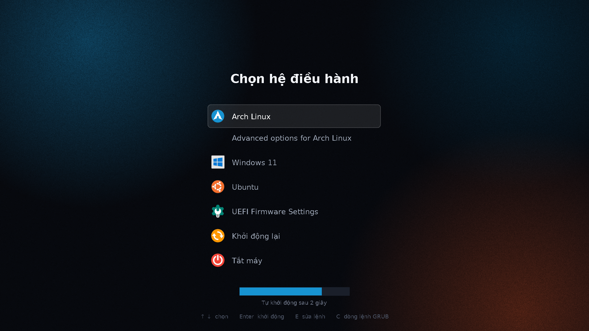
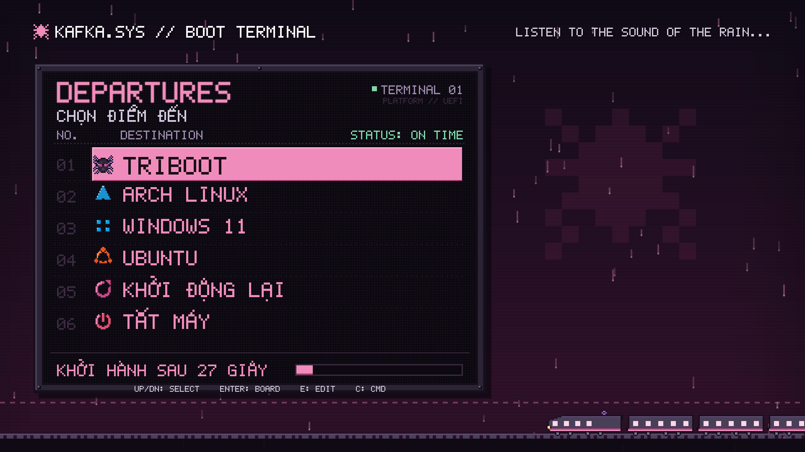
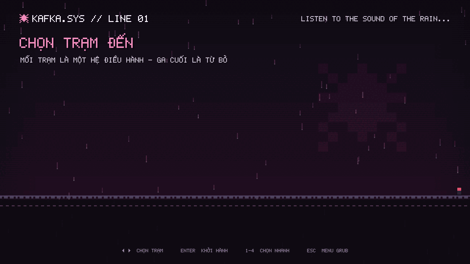

# Triboot

Unified UEFI boot menus, GRUB themes, and Plymouth splash screens for an **Arch Linux · Windows 11 · Ubuntu** triple-boot setup.

| Horizontal Menu (rEFInd / UEFI) | KAFKA.SYS Train Line (UEFI) | Vertical Menu (GRUB) | KAFKA.SYS GRUB Theme | Plymouth (Flat) | Plymouth (KAFKA.SYS) |
| :---: | :---: | :---: | :---: | :---: | :---: |
|  |  |  |  |  |  |

<p align="center">
  <br />
  <em><code>KAFKA.SYS // LINE 01</code> horizontal UEFI menu (<code>kafka-src/preview-line.gif</code>)</em>
</p>

<p align="center">
  <br />
  <em><code>KAFKA.SYS // DEPARTURES</code> GRUB intro animation (<code>kafka-src/preview-intro.gif</code>)</em>
</p>

> Previews in the repository use a procedural fallback background (purple twilight and spider emblem) without copyrighted character art. At install time, scripts automatically pull wallpaper assets from `KAFKA_DESKTOP_DIR` if present.

## Features

| Component | Path | Description |
| :--- | :--- | :--- |
| **rEFInd Theme** | `refind/` | Minimal 3-OS horizontal menu with time-of-day greetings (morning/afternoon/evening via `triboot-greeting.service`) and uncompressed `BMP` banners for instant loading. |
| **Custom UEFI Menu** | `uefi-menu/src/triboot.c` | Freestanding C UEFI app (`triboot.efi`, no `gnu-efi`), ~60 FPS sliding transitions, breathing icon glow, hardware RTC greeting, and per-OS countdown bar (10s timeout). |
| **KAFKA.SYS // LINE 01** | `uefi-menu/src/kafka.c` | Freestanding C UEFI horizontal train-line menu (`kafka.efi`) with `.tbi` assets from `kafka-src/make-kafka-line.py`. Auto-detects installed OS loaders across GPT partitions, animates a pixel train between stations at ~60 FPS, and includes a terminal **"TỪ BỎ"** station for Shutdown/Reboot. Keys: `←`/`→` or `↑`/`↓`, `1`–`4`, `Enter`, `Esc` (return to GRUB). |
| **Plymouth Splash** | `effects/` | Synchronized boot/shutdown/reboot splash for Arch and Ubuntu. Defaults to `kafka` pixel style (train arriving on boot, departing on shutdown/reboot, greeting window, pixel progress blocks); set `TRIBOOT_PLYMOUTH=flat` for the minimal logo glow theme. |
| **Triboot GRUB Theme** | `triboot/` | Clean vertical GRUB fallback menu (`fallback=1` boots Arch Linux if the primary chainloaded menu fails) with extra GRUB scripts hidden via a pacman hook. |
| **KAFKA.SYS // DEPARTURES** | `kafka/`, `kafka-src/` | 1920x1080 train-station LED departure board GRUB theme with custom 16x16 pixel OS icons, Vietnamese pixel font (`Kafka Pixel VN`), and a pre-rendered flip-board intro animation (`intro-NN.png` driven by `/etc/grub.d/05_kafka_intro` using `background_image`, `clear`, and `play 6000 0 N`). |

## Requirements

**Arch Linux:**
```bash
# Core dependencies (python-cairo is required for default KAFKA.SYS Plymouth/theme generation)
sudo pacman -S --needed grub efibootmgr refind plymouth imagemagick librsvg ttf-dejavu papirus-icon-theme gcc binutils make python-cairo

# Optional: for QEMU/OVMF preview rendering (--kafka-preview, uefi-menu/test/run.py)
sudo pacman -S --needed edk2-ovmf qemu-desktop
```

**Ubuntu (20.04+):**
```bash
sudo apt install plymouth plymouth-themes python3-cairo
```

## Installation

```bash
git clone https://github.com/TaZek244/grub-theme-3os.git && cd grub-theme-3os
```

This was written for the author's own triple-boot machine. Update partition UUIDs/GUIDs in [Configuration](#configuration) before running it anywhere else.

### Arch Linux
```bash
# Full installation (GRUB + BOOT_MODE menu + Plymouth + fast-boot + Ubuntu sync)
sudo ./install.sh --all

# Quick update (regenerate greetings & Plymouth + fast-boot + sync to Ubuntu)
sudo ./install.sh
sudo ./install.sh --name "Your Name"
```

### Ubuntu (20.04+)
Run directly inside Ubuntu (running `sudo ./install.sh` without flags on Ubuntu automatically selects `--ubuntu`):
```bash
sudo ./install.sh --ubuntu
# Keep Ubuntu's GRUB menu visible instead of booting straight into Ubuntu:
TRIBOOT_UBUNTU_HIDE_GRUB=0 sudo -E ./install.sh --ubuntu
```
What `--ubuntu` does:
- Installs `plymouth`, `plymouth-themes`, and `python3-cairo`.
- Builds the `KAFKA.SYS` Plymouth theme (searching `KAFKA_DESKTOP_DIR` locally, then mounting `ARCH_ROOT_UUID` read-only to check Arch `/home`, or falling back to procedural art).
- Sets `triboot-ubuntu` via `update-alternatives`, enables `quiet splash` and `FRAMEBUFFER=y`, hides Ubuntu's secondary GRUB menu, and installs `triboot-plymouth-refresh.service` so future `--effects` syncs from Arch automatically trigger `update-initramfs -u` on next Ubuntu boot.

## Usage

| Command | Root | Description |
| :--- | :---: | :--- |
| `sudo ./install.sh` | Yes | Rebuild greetings/Plymouth, apply fast-boot (if rEFInd), and sync Plymouth to Ubuntu. |
| `sudo ./install.sh --all [--theme triboot\|kafka]` | Yes | Full install of GRUB, configured `BOOT_MODE`, Plymouth, and fast-boot. |
| `sudo ./install.sh --effects` | Yes | Rebuild greetings and update Plymouth on Arch + sync to Ubuntu. |
| `sudo ./install.sh --refind` | Yes | Install rEFInd theme on Arch ESP and apply BMP fast-boot. |
| `sudo ./install.sh --uefi` | Yes | Build `.tbi` assets + `triboot.efi`, install to `/boot/EFI/triboot`, and chainload from GRUB. |
| `sudo ./install.sh --kafka-line` | Yes | Build `.tbi` assets + `kafka.efi`, install to `/boot/EFI/kafka`, and chainload from GRUB. |
| `sudo ./install.sh --grub [--theme triboot\|kafka]` | Yes | Install vertical GRUB theme and 3-OS boot entries (`/etc/grub.d/11_triboot`). |
| `sudo ./install.sh --kafka` | Yes | Build and install `KAFKA.SYS // DEPARTURES` GRUB theme (activates in `/etc/default/grub` only when `BOOT_MODE="grub"`). |
| `sudo ./install.sh --fast-boot` | Yes | Convert rEFInd banners to uncompressed BMP and hide intermediate GRUB menu. |
| `sudo ./install.sh --ubuntu` | Yes | Install Plymouth theme and hide secondary GRUB menu inside Ubuntu. |
| `./install.sh --assets` | No | Generate PNG/TBI assets for `effects/` and `uefi-menu/build/` only. |
| `./install.sh --kafka-assets` | No | Generate `KAFKA.SYS` GRUB images, intro frames, `theme.txt`, icons, and `.pf2` fonts in `kafka/`. |
| `./install.sh --kafka-preview` | No | Boot real GRUB in QEMU/OVMF and capture `preview-kafka.png` and `preview-kafka-intro.gif`. |
| `./install.sh --kafka-line-build` | No | Build `KAFKA.SYS // LINE 01` `.tbi` assets and compile `uefi-menu/out/kafka.efi`. |

### Troubleshooting & Notes
- **Viewing `KAFKA.SYS` GRUB theme on every boot:** When `BOOT_MODE` is `"refind"` or `"uefi"` with `FAST_BOOT=1`, GRUB is hidden. Set `BOOT_MODE="grub"` in [`lib/config.sh`](lib/config.sh) before running `sudo ./install.sh --kafka`.
- **Editing `kafka/theme.txt`:** `kafka/theme.txt` is auto-generated from the `LAYOUT` dictionary in `kafka-src/make-kafka-theme.py`. Edit `make-kafka-theme.py` rather than `theme.txt`.
- **Ubuntu recovery menu:** Hold `Shift` (BIOS) or press `Esc` (UEFI) during boot to access Ubuntu's hidden GRUB menu.
- **Ubuntu limitations:** Encrypted disks (`/etc/crypttab`) are not supported (no password prompt in theme). Plymouth 0.9.4 on Ubuntu 20.04 may display the shutdown text during reboot.

## Configuration

> [!WARNING]
> Before installing on a new machine, inspect your partition UUIDs and PARTUUIDs with `lsblk -f` or `blkid` and update [`lib/config.sh`](lib/config.sh). If you use `refind`, `triboot.efi`, or `kafka.efi`, also update the hardcoded GPT partition GUIDs and root UUIDs in [`refind/refind.conf`](refind/refind.conf), [`uefi-menu/src/triboot.c`](uefi-menu/src/triboot.c), and [`uefi-menu/src/kafka.c`](uefi-menu/src/kafka.c).

Key settings in [`lib/config.sh`](lib/config.sh):

| Variable | Default | Purpose |
| :--- | :--- | :--- |
| `USER_NAME` | `"${TRIBOOT_NAME:-TaZek}"` | Display name on greetings/farewells (`""` to omit; or pass `--name`). |
| `BOOT_MODE` | `"${TRIBOOT_MODE:-refind}"` | Primary boot menu for `--all`: `"refind"`, `"uefi"`, or `"grub"`. |
| `FAST_BOOT` | `1` | Hide intermediate GRUB menu (`GRUB_TIMEOUT=0`, console output) and use uncompressed BMP banners in rEFInd. |
| `MENU_TIMEOUT` / `RESOLUTION` | `8` / `"1920x1080"` | GRUB timeout (seconds) and screen resolution (`kafka` layout is fixed at `1920x1080`). |
| `GRUB_THEME_NAME` | `"${TRIBOOT_GRUB_THEME:-triboot}"` | Vertical GRUB theme: `"triboot"` or `"kafka"` (or pass `--theme`). |
| `PLYMOUTH_STYLE` | `"${TRIBOOT_PLYMOUTH:-kafka}"` | Plymouth splash style: `"kafka"` (pixel train) or `"flat"`. |
| `KAFKA_DESKTOP_DIR` | `~/Desktop/repo_4Fun/custom_desktop` | Path to Kafka Hyprland dotfiles repo for wallpaper (`wallpapers/kafka_landscape_3.jpg` or `greetd/kafka-greeter/bg-pixel.png`) and font builder (`fonts/build-kafka-pixel-font.py --vietnamese`). Falls back to procedural background and `KAFKA_FALLBACK_FONT` (`DejaVuSans-Bold.ttf`). |
| `KAFKA_MONO_FONT` | `DejaVuSansMono-Bold.ttf` | Monospace font for GRUB command line and entry editor (`C` / `E`). |
| `KAFKA_LINE_DEST` | `/boot/EFI/kafka` | Target directory on Arch ESP for `kafka.efi` and `.tbi` assets. |
| `UBUNTU_HIDE_GRUB` | `"${TRIBOOT_UBUNTU_HIDE_GRUB:-1}"` | Hide Ubuntu's own GRUB menu (`GRUB_TIMEOUT=0`, `GRUB_RECORDFAIL_TIMEOUT=0`, `GRUB_DISABLE_OS_PROBER=true`). |
| `ARCH_ESP_UUID`, `ARCH_ESP_PARTUUID`, `ARCH_ROOT_UUID` | *(machine-specific)* | Arch Linux EFI (`/boot`) and root (`/`) UUIDs/PARTUUID. |
| `NVME_ESP_UUID`, `NVME_ESP_PARTUUID`, `UBUNTU_ROOT_UUID` | *(machine-specific)* | Shared Windows/Ubuntu EFI partition and Ubuntu root (`/`) UUIDs/PARTUUID. |

## Uninstall

Every modification backs up original files under `/root/*-backup`. Restore full or component configurations with `--undo`:

```bash
sudo ./install.sh --undo               # Undo fast-boot, effects, and GRUB changes on Arch
sudo ./install.sh --refind --undo      # Remove rEFInd boot entry and restore previous rEFInd/GRUB
sudo ./install.sh --uefi --undo        # Remove triboot.efi and fall back to rEFInd/GRUB
sudo ./install.sh --kafka-line --undo  # Remove kafka.efi and fall back to triboot.efi or rEFInd
sudo ./install.sh --kafka --undo       # Remove kafka GRUB theme and /etc/grub.d/05_kafka_intro
sudo ./install.sh --grub --undo        # Restore original /etc/default/grub and grub.cfg
sudo ./install.sh --effects --undo     # Remove greeting service and restore Arch Plymouth/mkinitcpio
sudo ./install.sh --fast-boot --undo   # Restore PNG banners and pre-fast-boot GRUB config
sudo ./install.sh --ubuntu --undo      # Run inside Ubuntu: restore default Plymouth and Ubuntu GRUB menu
```

## Project Layout

```text
grub-theme-3os/
├── install.sh              # Single CLI entry point for install, asset build, preview, and undo
├── lib/                    # Modular installer libraries (config, common, grub, refind, effects, uefi, kafka)
├── triboot/                # Default vertical GRUB theme assets
├── kafka/                  # Generated KAFKA.SYS // DEPARTURES GRUB theme (theme.txt, frames, icons, .pf2)
├── kafka-src/              # Python/Cairo generators (make-kafka-theme.py, make-kafka-line.py, make-kafka-plymouth.py,
│                           #   make-icons.py, sprites.py, pixelfont.py, vnglyphs.json) & QEMU preview scripts
├── refind/                 # rEFInd configuration template and horizontal theme assets
├── effects/                # Plymouth themes (Arch & Ubuntu) and time-of-day banners
└── uefi-menu/              # Freestanding C UEFI menus (src/triboot.c, src/kafka.c, src/efi.h, Makefile, test/run.py)
```

## License

- UEFI applications, installer scripts, and Plymouth scripts: **MIT License**.
- `triboot` OS icons derived from [Papirus Icon Theme](https://github.com/PapirusDevelopmentTeam/papirus-icon-theme) (**GPL-3.0**).
- 16x16 pixel OS icons in `kafka/` (`kafka-src/make-icons.py`): original pixel art for this project. Copyrighted character artwork is not distributed in this repository.
- Generated text assets use **DejaVu Fonts** (**Bitstream Vera / Public Domain**).
