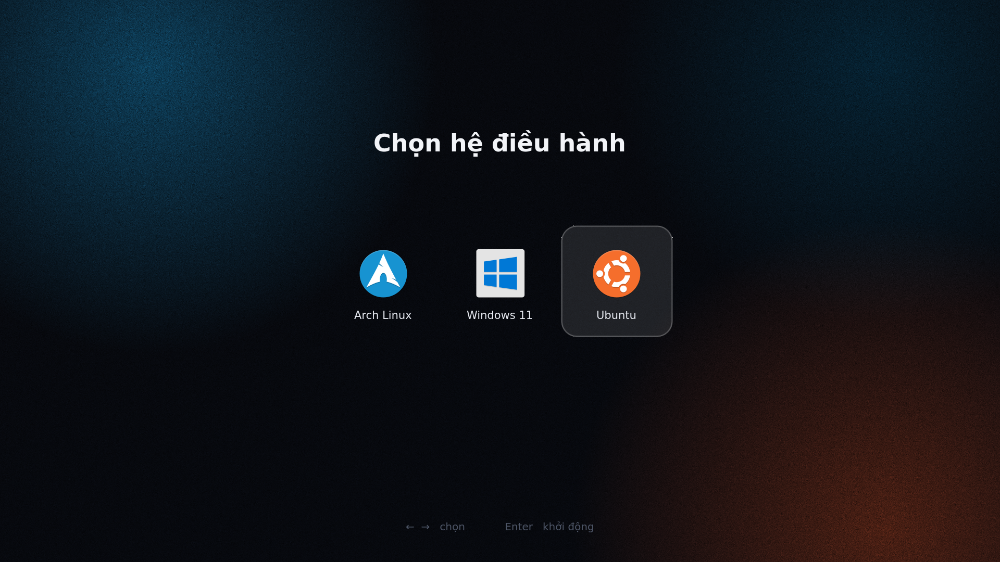
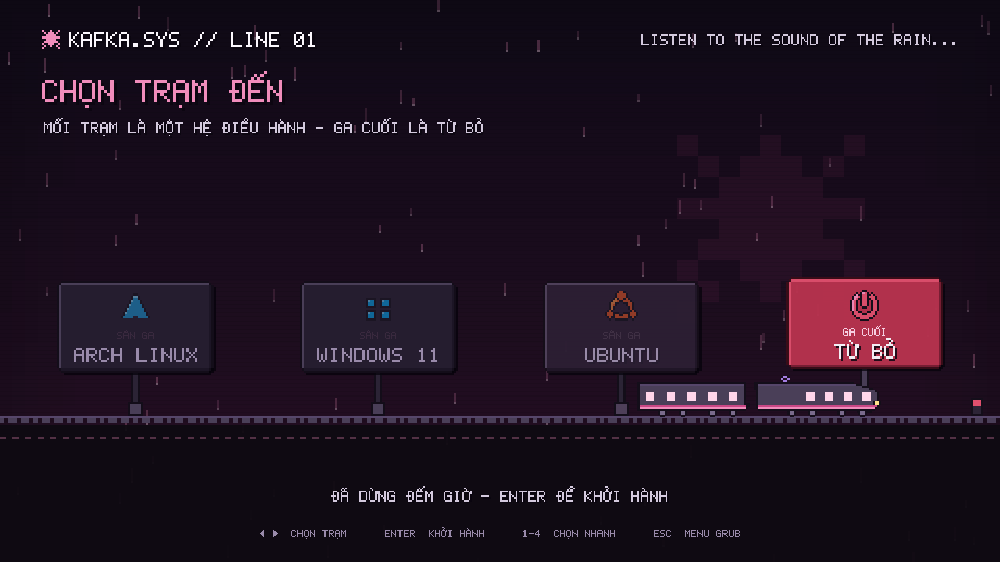
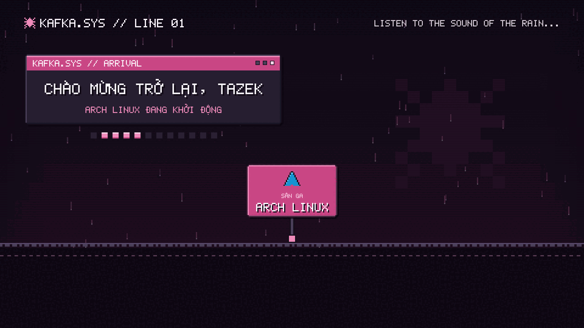

# Triboot — Bộ giao diện khởi động 3 hệ điều hành (Arch Linux · Windows 11 · Ubuntu)

Bộ giao diện và công cụ quản lý khởi động đồng bộ dành cho máy tính chạy **Triple-Boot (Arch Linux, Windows 11, Ubuntu)** chuẩn UEFI, bao gồm:

1. **Menu chọn hệ điều hành dạng ngang**:
   - **rEFInd Theme (`refind/`)**: Giao diện tối giản chỉ hiện 3 icon hệ điều hành, tự động đổi **lời chào theo buổi** (*Chào buổi sáng / chiều / tối*) và tối ưu tải tức thì bằng ảnh `BMP` không nén (`fast-boot`).
   - **Custom UEFI Menu (`uefi-menu/`)**: Ứng dụng UEFI độc lập viết bằng C thuần (`triboot.efi`, không phụ thuộc `gnu-efi`), chạy ở 60 FPS với hiệu ứng trượt mượt, quầng sáng "thở" (`breath`), tự tính giờ địa phương từ phần cứng và thanh đếm ngược theo màu từng hệ điều hành.
   - **Menu tuyến tàu ngang `KAFKA.SYS // LINE 01` (`uefi-menu/src/kafka.c`)**: Ứng dụng UEFI tự viết bằng C (`kafka.efi`), bộ ảnh `.tbi` do `kafka-src/make-kafka-line.py` sinh sẵn:
     - **Màn hình tuyến tàu ngang**: Mỗi trạm là một hệ điều hành **đã cài** (ứng dụng tự dò loader trên các phân vùng GPT; trạm nào không tìm thấy loader thì tự ẩn, các trạm còn lại chia đều trên đường ray), cuối tuyến luôn là ga cuối **"TỪ BỎ"** màu đỏ. Chọn *"TỪ BỎ"* rồi nhấn `Enter` sẽ mở hộp thoại **"TỪ BỎ HÀNH TRÌNH?"** với 2 nút **Tắt máy** / **Khởi động lại** (`←`/`→` chọn, `Enter` xác nhận, `Esc` ở lại).
     - **Hiệu ứng (~60 khung/giây)**: Lúc mở menu, đoàn tàu pixel chạy từ mép trái vào ga và các biển trạm hiện lần lượt; khi đổi trạm, tàu chạy mượt tới trạm đó và chậm dần khi vào ga; nhấn `Enter` tàu sẽ rời ga nhanh dần rồi mới khởi động hệ điều hành. Đi kèm bộ đếm ngược *"Khởi hành sau N giây"* (10 giây, tự dừng khi bấm phím).
     - **Phím điều khiển**: `←`/`→` (hoặc `↑`/`↓`) chọn trạm, `1`–`4` chọn nhanh, `Enter` khởi hành, `Esc` quay về menu GRUB.
     - **Phông chữ & ảnh nền**: Toàn bộ chữ tiếng Việt có dấu được vẽ sẵn bằng font pixel (`kafka-src/vnglyphs.json`, xuất từ font *Kafka Pixel VN* của bộ dotfiles). Ảnh nền tự động lấy từ repo dotfiles nếu có (ưu tiên `wallpapers/kafka_landscape_3.jpg`, rồi đến `greetd/kafka-greeter/bg-pixel.png`), không có thì dùng nền tự vẽ; ảnh bản quyền không nằm trong repo.
2. **Màn hình chờ Plymouth (`effects/`)**:
   - Đồng bộ cho cả **Arch Linux** và **Ubuntu**; mặc định dùng bản pixel **`KAFKA.SYS`** (`PLYMOUTH_STYLE="kafka"` trong [`lib/config.sh`](lib/config.sh), đặt `TRIBOOT_PLYMOUTH=flat` để dùng bản phẳng cũ).
   - Tự động phân biệt trạng thái hệ thống:
     - **Khi bật máy (`boot-up`)**: Đoàn tàu pixel chạy vào "ga" của hệ điều hành và dừng dưới biển trạm (`ARCH LINUX` / `UBUNTU`, cùng bộ với menu tuyến tàu `LINE 01`), hộp kiểu cửa sổ game bên trái hiện *"CHÀO MỪNG TRỞ LẠI, <TÊN>"* + *"<HĐH> ĐANG KHỞI ĐỘNG"*, thanh tải là dãy ô pixel chạy.
     - **Khi tắt máy (`shutdown`) / khởi động lại (`reboot`)**: Đoàn tàu rời ga nhanh dần, hộp cửa sổ hiện *"HẸN GẶP LẠI, <TÊN>"* + *"ĐANG TẮT MÁY"* / *"ĐANG KHỞI ĐỘNG LẠI"*.
   - **Sinh tài nguyên & tự động chuyển đổi**: Ảnh và script bản pixel do `kafka-src/make-kafka-plymouth.py` sinh lúc cài vào `effects/build-kafka/{arch,ubuntu}` (đã gitignore; ảnh nền Kafka tự lấy từ repo dotfiles, không có thì dùng nền tự vẽ). Nếu chưa có bản pixel hoặc chọn `flat`, trình cài đặt (`_ply_src`) tự động dùng bản phẳng cũ trong `effects/plymouth-theme` và `effects/plymouth-ubuntu`.
3. **Theme GRUB dự phòng (`triboot/`)**:
   - Giao diện GRUB dọc gọn gàng, tự động ẩn các mục thừa và làm menu dự phòng an toàn (`fallback=1` tự rơi về Arch Linux nếu bộ nạp chính gặp sự cố).
4. **Theme GRUB pixel `KAFKA.SYS // DEPARTURES` (`kafka/`)**:
   - Giao diện lấy ý tưởng **bootloader là một nhà ga**, đồng bộ với bộ dotfiles Hyprland **"Kafka"** (*Honkai: Star Rail*) và trình đăng nhập pixel **KAFKA.SYS**: bên trái là **bảng giờ tàu LED** lớn (khung kim loại có đinh tán, nền đen chấm LED), tiêu đề `DEPARTURES` + dòng phụ *"Chọn điểm đến"*, cột `NO.` / `DESTINATION` nơi mỗi hệ điều hành là một "điểm đến" (kèm bộ biểu tượng pixel 16x16 vẽ tay riêng), mục đang chọn là **vạch LED hồng đảo màu** (nền hồng sáng, chữ tối, cỡ chữ bật từ `35` → `42`); đáy bảng là dòng đếm ngược *"Khởi hành sau %d giây"* cùng thanh tiến độ và dải phím gợi ý (`UP/DN: SELECT`, `ENTER: BOARD`, `E: EDIT`, `C: CMD`).
   - **Bố cục cảnh nhà ga (`1920x1080`)**: Kafka đứng ở phần ba bên phải (ảnh nền pixel hóa dời sang phải kèm hiệu ứng vignette bậc, scanline và mưa pixel), thanh tiêu đề trên cùng (`KAFKA.SYS // BOOT TERMINAL` + `"LISTEN TO THE SOUND OF THE RAIN..."`), đáy màn hình là đường ray, vạch cảnh báo mép sân ga và **đoàn tàu pixel** đang đỗ (`kafka-src/sprites.py`). Phông chữ pixel **"Kafka Pixel VN"** hỗ trợ đầy đủ dấu tiếng Việt.
   - **Hiệu ứng xuất hiện (Appearance Effect)** trước khi vào menu: đoàn tàu chạy vào ga rồi dừng lại → bảng giờ tàu bật nguồn → các hàng chữ LED lật loạn xạ rồi dừng lại thành menu chính.
   - **Cơ chế hoạt động của hiệu ứng xuất hiện**:
     - GRUB không hỗ trợ hoạt ảnh gốc, nên `kafka-src/make-kafka-theme.py` kết xuất sẵn chuỗi khung hình `intro-NN.png` cùng file `intro.txt` (ghi thời gian giữ mỗi khung tính bằng `1/100` giây, khung cuối trùng khớp `background.png`). File cấu hình `kafka/theme.txt` cũng được sinh tự động từ bảng `LAYOUT` trong script Python (khi cần chỉnh bố cục, hãy sửa trong `make-kafka-theme.py` thay vì sửa trực tiếp `theme.txt`).
     - Khi cài đặt, trình cài đặt tạo `/etc/grub.d/05_kafka_intro` (gọi `intro-cfg.sh`) để sinh lệnh GRUB vẽ lần lượt từng khung bằng `background_image`, gọi `clear` để ép đẩy khung hình ra màn hình (do `gfxterm` vẽ vào bộ đệm ẩn / back buffer), rồi chờ bằng `play 6000 0 N` (lệnh phát tiếng nghỉ im lặng của loa PC speaker trong `N × 10 ms` ở tempo `6000`, vì lệnh `sleep` của GRUB chỉ nhận số giây nguyên).
     - Hiệu ứng chỉ chạy khi `GRUB_THEME` là theme `kafka`, đầu ra là `gfxterm` và menu không bị ẩn (`GRUB_TIMEOUT_STYLE != hidden`); lệnh hoàn tác (`--undo`) sẽ tự động gỡ bỏ `/etc/grub.d/05_kafka_intro`.

---

## Hình ảnh minh họa

| Menu ngang (rEFInd / UEFI) | Tuyến tàu ngang KAFKA.SYS (UEFI) | Menu dọc (GRUB) | Theme GRUB KAFKA.SYS | Màn hình Plymouth (Phẳng) | Màn hình Plymouth KAFKA.SYS |
| :---: | :---: | :---: | :---: | :---: | :---: |
|  |  |  |  |  |  |

<p align="center">
  
  <br />
  <em>Menu UEFI tuyến tàu ngang <code>KAFKA.SYS // LINE 01</code> (<code>kafka-src/preview-line.gif</code>)</em>
</p>

<p align="center">
  
  <br />
  <em>Hiệu ứng xuất hiện (Appearance Effect) của theme GRUB KAFKA.SYS (<code>kafka-src/preview-intro.gif</code>)</em>
</p>

> *Lưu ý: Các ảnh xem trước `kafka-src/preview.png`, `kafka-src/preview-line.png` và ảnh động `kafka-src/preview-intro.gif`, `kafka-src/preview-line.gif`, `effects/preview-plymouth-kafka.gif` đều được vẽ bằng nền tự vẽ (chạng vạng tím + biểu tượng nhện mờ, không chứa ảnh nhân vật có bản quyền); khi cài đặt trên máy, script sẽ tự động lấy ảnh nền từ thư mục repo dotfiles.*

---

## Cấu trúc thư mục

Toàn bộ dự án sử dụng **duy nhất 1 script chạy [`install.sh`](install.sh)** ở thư mục gốc, các cấu hình và hàm xử lý được tách thành mô-đun trong [`lib/`](lib/):

```text
grub-theme-3os/
├── install.sh              # Trình cài đặt, cập nhật & hoàn tác duy nhất
├── lib/
│   ├── config.sh           # Cấu hình trung tâm (Tên, chế độ boot, UUID phân vùng, màu sắc)
│   ├── common.sh           # Các hàm tiện ích dùng chung & kiểm tra an toàn
│   ├── grub.sh             # Quản lý GRUB, ẩn mục thừa, tạo pacman hook, tối ưu fast-boot
│   ├── refind.sh           # Cài đặt rEFInd & tối ưu ảnh nền BMP không nén
│   ├── effects.sh          # Sinh ảnh lời chào/tạm biệt, cài đặt Plymouth (Arch & Ubuntu)
│   ├── uefi.sh             # Tạo asset .tbi, biên dịch và cài đặt ứng dụng UEFI (triboot.efi)
│   └── kafka.sh            # Sinh tài nguyên (ảnh, icon, font .pf2), hook intro & xem trước QEMU cho theme KAFKA.SYS
├── triboot/                # Tài nguyên theme GRUB mặc định (ảnh nền, icon, font .pf2)
├── kafka/                  # Cấu hình theme.txt (tự sinh từ LAYOUT) & tài nguyên sinh ra của theme GRUB KAFKA.SYS
├── kafka-src/              # Bộ công cụ nguồn sinh tài nguyên & xem trước cho theme KAFKA.SYS
│   ├── make-kafka-theme.py # Sinh ảnh nền nhà ga, bảng giờ tàu LED DEPARTURES, theme.txt & các khung intro-NN.png
│   ├── make-kafka-line.py  # Sinh bộ ảnh .tbi cho menu UEFI tuyến tàu ngang KAFKA.SYS // LINE 01
│   ├── make-kafka-plymouth.py # Sinh theme Plymouth pixel KAFKA.SYS (tàu vào/rời ga, hộp cửa sổ chào/tạm biệt & dãy ô tải)
│   ├── vnglyphs.json       # Dữ liệu glyph tiếng Việt có dấu xuất từ font Kafka Pixel VN
│   ├── sprites.py          # Sprite pixel-art đường ray & đoàn tàu (đầu tàu + toa tàu)
│   ├── make-icons.py       # Sinh bộ biểu tượng hệ điều hành pixel-art 16x16 nguyên bản
│   ├── pixelfont.py        # Bộ vẽ chữ bitmap 5x7 cho các nhãn tĩnh và chữ LED trên bảng
│   ├── intro-cfg.sh        # Sinh đoạn cấu hình GRUB chạy chuỗi khung hình hiệu ứng xuất hiện (intro.txt)
│   ├── preview-qemu.sh     # Chạy GRUB thật trong QEMU/OVMF để chụp ảnh & quay GIF xem trước
│   ├── preview.png         # Ảnh xem trước màn hình menu GRUB KAFKA.SYS (vẽ bằng nền tự vẽ, không có ảnh bản quyền)
│   ├── preview-intro.gif   # Ảnh động GIF xem trước hiệu ứng xuất hiện KAFKA.SYS (nền tự vẽ)
│   ├── preview-line.png    # Ảnh xem trước menu UEFI tuyến tàu ngang KAFKA.SYS // LINE 01 (nền tự vẽ)
│   └── preview-line.gif    # Ảnh động GIF xem trước menu UEFI tuyến tàu ngang KAFKA.SYS // LINE 01 (nền tự vẽ)
├── refind/                 # Cấu hình mẫu refind.conf & theme rEFInd
├── effects/                # Tài nguyên Plymouth (Arch & Ubuntu) và banner 3 buổi
└── uefi-menu/              # Mã nguồn C của ứng dụng UEFI menu (src/triboot.c, src/kafka.c, src/efi.h)
```

---

## Yêu cầu hệ thống (Dependencies)

Trên **Arch Linux**:
```bash
sudo pacman -S --needed grub efibootmgr refind plymouth imagemagick librsvg ttf-dejavu papirus-icon-theme gcc binutils make
```
*(Nếu dùng thêm tính năng tạo theme & chụp ảnh xem trước `KAFKA.SYS` bằng `qemu-system-x86_64`)*:
```bash
sudo pacman -S --needed python-cairo edk2-ovmf qemu-desktop   # hoặc gói qemu-full
```

Trên **Ubuntu** *(nếu cài Plymouth trực tiếp từ trong Ubuntu)*:
```bash
sudo apt install plymouth plymouth-themes
```

---

## Cấu hình trước khi cài đặt (Quan trọng!)

> [!WARNING]
> **Mỗi máy tính có UUID/PARTUUID phân vùng khác nhau.** Trước khi chạy trên một máy mới, bạn **bắt buộc** phải kiểm tra bằng lệnh `lsblk -f` hoặc `blkid` và cập nhật lại mục **2. Thông tin phân vùng phần cứng** trong file [`lib/config.sh`](lib/config.sh):

```bash
# Mở file cấu hình trung tâm:
nano lib/config.sh
```

Các thông số chính trong [`lib/config.sh`](lib/config.sh):
- `USER_NAME="TaZek"`: Tên hiển thị trên lời chào / lời tạm biệt (để `""` nếu không muốn hiện tên).
- `BOOT_MODE="refind"`: Chọn `"refind"` | `"uefi"` | `"grub"`.
- `FAST_BOOT=1`: Tắt màn hình đồ họa GRUB trung gian và dùng ảnh BMP không nén để vào thẳng menu nhanh nhất.
- `GRUB_THEME_NAME="triboot"`: Chọn theme GRUB dọc (`"triboot"` gọn gàng trung tính | `"kafka"` phong cách bảng giờ tàu pixel `KAFKA.SYS // DEPARTURES`).
- `KAFKA_DESKTOP_DIR`: Đường dẫn tới repo dotfiles Hyprland Kafka để tự động lấy ảnh nền (ưu tiên `wallpapers/kafka_landscape_3.jpg` được pixel hóa về `480x270`, không có thì dùng `greetd/kafka-greeter/bg-pixel.png`, không có nữa thì dùng nền tự vẽ) và script dựng phông chữ (`fonts/build-kafka-pixel-font.py --vietnamese`).
- `KAFKA_MONO_FONT`: Phông chữ monospace cho màn hình dòng lệnh / soạn thảo lệnh GRUB (phím `C` / `E`).
- `KAFKA_FALLBACK_FONT`: Phông chữ dự phòng đầy đủ dấu tiếng Việt (mặc định `DejaVuSans-Bold.ttf`) dùng khi không dựng được font `Kafka Pixel VN`.
- `KAFKA_LINE_DEST`: Thư mục cài đặt ứng dụng UEFI menu tuyến tàu ngang `KAFKA.SYS // LINE 01` trên phân vùng ESP của Arch (mặc định `/boot/EFI/kafka`).
- `PLYMOUTH_STYLE="${TRIBOOT_PLYMOUTH:-kafka}"`: Giao diện màn hình chờ Plymouth (`"kafka"` bản pixel `KAFKA.SYS` tàu vào/rời ga mặc định | `"flat"` bản phẳng cũ; có thể đổi bằng `TRIBOOT_PLYMOUTH=flat`).
- `ARCH_ESP_UUID`, `ARCH_ESP_PARTUUID`, `ARCH_ROOT_UUID`: UUID/PARTUUID của phân vùng EFI (`/boot`) và Root (`/`) của Arch Linux.
- `NVME_ESP_UUID`, `NVME_ESP_PARTUUID`, `UBUNTU_ROOT_UUID`: UUID/PARTUUID của phân vùng EFI chứa Windows/Ubuntu và phân vùng Root (`/`) của Ubuntu.

---

## Hướng dẫn sử dụng

### 1. Cập nhật nhanh lời chào / tạm biệt + Plymouth + Fast-Boot
```bash
sudo ./install.sh
```
Hoặc đổi tên hiển thị ngay từ dòng lệnh:
```bash
sudo ./install.sh --name "Tên của bạn"
```

### 2. Cài đặt toàn bộ từ đầu
```bash
sudo ./install.sh --all
```

### 3. Chạy riêng từng phần theo nhu cầu
```bash
sudo ./install.sh --effects     # Chỉ tạo lại ảnh lời chào/tạm biệt & cập nhật Plymouth + đồng bộ Ubuntu
sudo ./install.sh --refind      # Cài đặt rEFInd + tối ưu fast-boot
sudo ./install.sh --uefi        # Biên dịch & cài đặt menu ngang UEFI tự viết (triboot.efi)
sudo ./install.sh --grub        # Cài đặt theme GRUB dọc truyền thống
sudo ./install.sh --fast-boot   # Bật tối ưu khởi động nhanh (BMP + ẩn GRUB trung gian)
sudo ./install.sh --ubuntu      # Cài Plymouth cho Ubuntu (chạy khi đang ở trong Ubuntu)
./install.sh --assets           # Chỉ tạo lại toàn bộ file ảnh (không cần sudo)
```

### 4. Theme GRUB KAFKA.SYS & Menu tuyến tàu ngang `KAFKA.SYS // LINE 01`
**Theme GRUB dọc (`KAFKA.SYS // DEPARTURES`)**:
```bash
./install.sh --kafka-assets             # Chỉ sinh ảnh, khung intro, theme.txt, icon và font .pf2 vào thư mục kafka/ (không cần sudo)
./install.sh --kafka-preview            # Chạy GRUB thật trong QEMU/OVMF (dùng KVM nếu có), xuất preview-kafka.png & GIF hiệu ứng preview-kafka-intro.gif
sudo ./install.sh --kafka               # Sinh tài nguyên & cài đặt trực tiếp theme GRUB KAFKA.SYS (kèm /etc/grub.d/05_kafka_intro)
sudo ./install.sh --theme kafka --grub  # Hoặc chọn theme kafka khi chạy --grub / --all (sudo ./install.sh --theme kafka --all)
sudo ./install.sh --kafka --undo        # Hoàn tác cài đặt theme GRUB KAFKA.SYS & gỡ 05_kafka_intro về cấu hình trước đó
```

**Menu UEFI tuyến tàu ngang (`KAFKA.SYS // LINE 01`)**:
```bash
./install.sh --kafka-line-build         # Không cần sudo: chỉ dựng ảnh .tbi vào uefi-menu/build-kafka/assets và biên dịch uefi-menu/out/kafka.efi
sudo ./install.sh --kafka-line          # Cài đặt vào /boot/EFI/kafka và cấu hình GRUB chainload làm mục đầu tiên (lỗi thì GRUB tự rơi về Arch Linux)
sudo ./install.sh --kafka-line --undo   # Gỡ bỏ menu tuyến tàu ngang, quay về triboot.efi hoặc rEFInd nếu còn
```
*(Có thể chạy thử trực tiếp trong QEMU bằng script `uefi-menu/test/run.py` tương tự như menu `triboot.efi`).*

> [!NOTE]
> Khi dùng `BOOT_MODE="refind"` hoặc `"uefi"` kết hợp với `FAST_BOOT=1`, menu GRUB sẽ được ẩn đi để vào thẳng hệ điều hành (chỉ xuất hiện khi chạy dự phòng `fallback`). Vì vậy, nếu muốn nhìn thấy theme GRUB `KAFKA.SYS` ở mỗi lần bật máy, hãy đặt `BOOT_MODE="grub"` trong [`lib/config.sh`](lib/config.sh). Khi chưa ở chế độ `grub`, `--kafka` chỉ chép theme vào `/boot/grub/themes/kafka` và **không** sửa `/etc/default/grub`, nên luồng khởi động hiện tại giữ nguyên.

### 5. Hoàn tác về cấu hình gốc (`--undo`)
Mọi bước can thiệp hệ thống đều tạo bản sao lưu tự động trong `/root/*-backup` trước khi sửa đổi:
```bash
sudo ./install.sh --undo
```

---

## Giấy phép & Nguồn tài nguyên
- Mã nguồn ứng dụng UEFI, script cài đặt và Plymouth script: **MIT License**.
- Biểu tượng hệ điều hành của theme `triboot` tạo từ bộ [Papirus Icon Theme](https://github.com/PapirusDevelopmentTeam/papirus-icon-theme) (**GPL-3.0**).
- Bộ biểu tượng hệ điều hành 16x16 trong `kafka/` (sinh bởi `kafka-src/make-icons.py`) là tác phẩm **pixel art nguyên bản** thuộc dự án này; các hình ảnh nhân vật Kafka có bản quyền **không** được phân phối kèm trong repo.
- Phông chữ tạo ảnh từ bộ **DejaVu Fonts** (**Bitstream Vera / Public Domain**).
